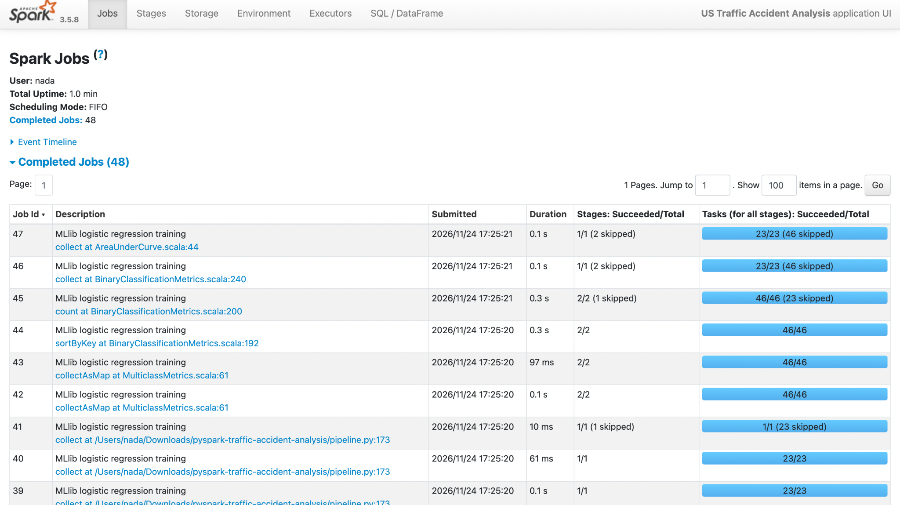
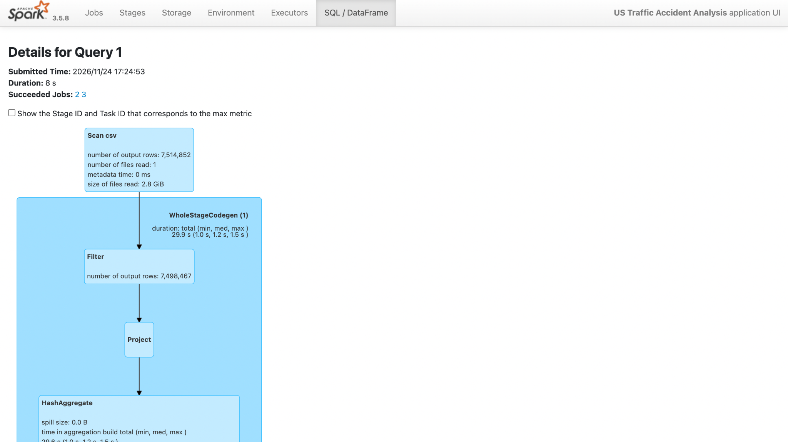
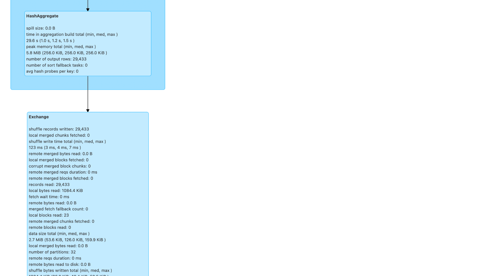
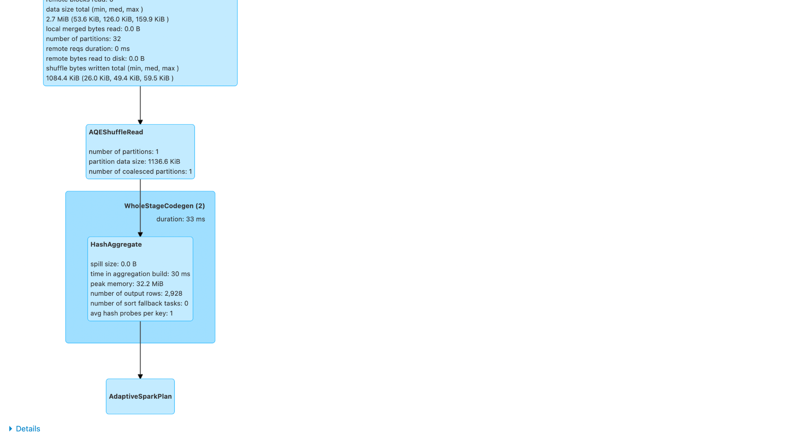
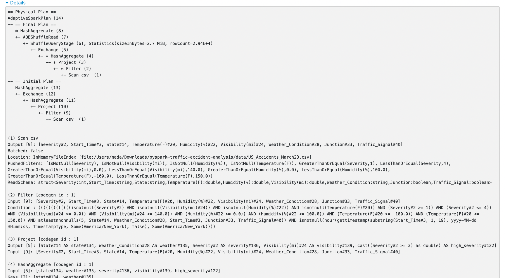
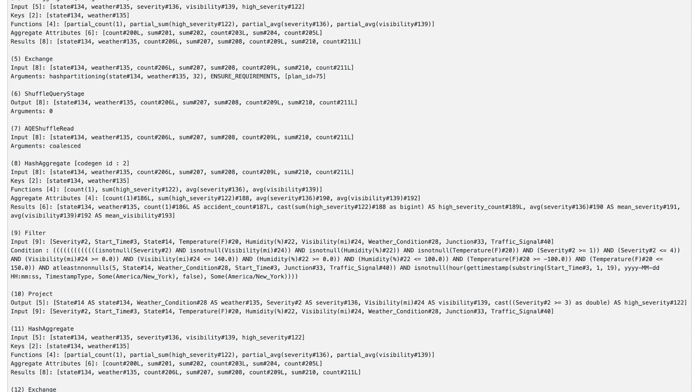
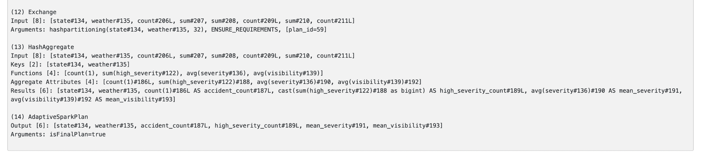

# Traffic Accident Severity Prediction Using PySpark

## Overview

This project looks at how weather, time of day, and road characteristics relate to the reported severity of US traffic accidents. It uses PySpark to process a large CSV dataset, summarize accident patterns with Spark SQL, and train a binary logistic regression model with Spark MLlib. The primary focus is distributed data processing, lazy evaluation, and query optimization.

## Dataset

- **Source:** [US Accidents (2016–2023), Sobhan Moosavi, Kaggle](https://www.kaggle.com/datasets/sobhanmoosavi/us-accidents)
- **File:** `US_Accidents_March23.csv`
- **Size:** 3.06 GB (2.8 GiB), ~7.7 million observations and 46 columns.
- **Coverage:** February 2016 - March 2023 across 49 US states.

The dataset includes accident location, time, weather, road characteristics, and a severity score from 1 to 4. Severity represents the impact on traffic, not the severity of injuries. The binary outcome is defined as higher severity (3–4) compared to lower severity (1–2). 

## Data processing pipeline

1. Load the CSV using an explicit schema and select nine relevant source columns.
2. Filter invalid severity, temperature, humidity, and visibility values, and remove records with missing required fields or invalid parsed hours.
3. Use `withColumn()` to extract the accident hour and create a binary severity label.
4. Group by state and weather condition to calculate accident counts, higher-severity counts, mean severity, and mean visibility.
5. Run two Spark SQL queries on the compact grouped results: higher-severity shares by state and by weather condition. Both queries require at least 1,000 retained records per group.
6. Write the three aggregated tables to Parquet and train a simple MLlib logistic regression model.

The descriptive analysis uses the full cleaned dataset. The machine learning step uses a reproducible 5% random sample to keep local execution manageable.

## Performance Analysis

The pipeline was executed locally using PySpark 3.5.8 with four worker threads and 4 GB of driver memory. To improve efficiency, filters were applied early in the pipeline to remove missing and invalid observations. The physical execution plan confirmed predicate pushdown through `PushedFilters` and column pruning through `ReadSchema`, as only nine of the original 46 columns were required for the analysis. After filtering, 7,498,467 records remained for processing.

The main performance bottleneck was reading and processing the original CSV file. To minimize unnecessary data movement, Spark performed partial aggregations before shuffling, reducing approximately 7.5 million records to 29,433 intermediate records. Adaptive Query Execution (AQE) further optimized the pipeline by reducing the 32 initial shuffle partitions to one for the final aggregation. Additionally, both SQL queries reused the aggregated dataset, avoiding unnecessary processing of the original data.

Caching improved performance by allowing Spark to reuse the cleaned DataFrame rather than repeatedly reading the CSV file. The aggregation time decreased from 8.12 seconds without caching to 0.65 seconds with caching, representing approximately a 12.5-fold speedup. However, initially caching the data took 11.19 seconds, demonstrating that caching is most beneficial when the same dataset is used for multiple operations. These results reflect a single local execution.

| Performance metric | Observed result |
| --- | ---: |
| Cleaned records | 7,498,467 |
| Input scan tasks | 23 |
| Initial shuffle partitions | 32 |
| Post-AQE shuffle partitions | 1 |
| Intermediate aggregation records | 29,433 |
| Final state-weather groups | 2,928 |
| Uncached aggregation | 8.12 s |
| Cache materialization | 11.19 s |
| Cached aggregation | 0.65 s |
| Aggregation disk spill | 0 B |

## Transformations vs. actions

Spark transformations such as `filter()` are lazy: they define a new DataFrame and its execution plan without immediately processing all records. Actions such as `count()` trigger execution and return a result. In this run, constructing the additional higher-severity filter took 0.0051 seconds, whereas the subsequent `count()` action took 6.85 seconds and returned 1,455,819 records. The script also uses `.explain(mode="formatted")` before and after execution to inspect the physical plan and the adaptive changes made by Spark.

## Key findings

Of the 7,498,467 cleaned accident records, 1,455,819 (19.41%) were classified as higher severity.

**SQL query 1: Higher-severity accidents by state**

| State | Recorded accidents | Higher-severity share |
| --- | ---: | ---: |
| Rhode Island | 16,236 | 46.52% |
| Georgia | 165,320 | 43.86% |
| Kentucky | 31,943 | 42.49% |

Rhode Island had the highest proportion of higher-severity reports among states meeting the minimum record threshold, followed by Georgia and Kentucky. These percentages describe recorded accidents, not the overall probability of experiencing an accident in each state.

**SQL query 2: Higher-severity accidents by weather condition**

| Weather condition | Recorded accidents | Higher-severity share |
| --- | ---: | ---: |
| Thunderstorms and Rain | 2,200 | 43.36% |
| Heavy Thunderstorms and Rain | 2,463 | 43.04% |
| Light Thunderstorms and Rain | 4,911 | 41.07% |
| Clear | 802,619 | 33.55% |

The three highest-ranked weather categories involved thunderstorms and rain. Their higher-severity shares exceeded that of clear conditions in the retained records. However, the data are observational; reporting practices, missing data, differences in traffic exposure, and other confounders may influence these comparisons. The results do not establish a causal effect of weather on severity.

## Machine learning: Logistic regression

A Spark MLlib logistic regression model was trained to predict higher-severity traffic disruption using temperature, humidity, visibility, accident hour, junction presence, and traffic signal presence. The model used a 5% sample of the cleaned records and an 80/20 random train-test split (seed 42), yielding 300,134 training records and 75,040 test records.

| Evaluation metric | Test result |
| --- | ---: |
| Accuracy | 0.8074 |
| Weighted F1-score | 0.7214 |
| ROC-AUC | 0.5676 |
| Majority-class accuracy baseline | 0.8074 |

Although the model achieved an accuracy of 80.74%, its performance was comparable to simply predicting the majority class. The ROC-AUC of 0.5676 suggests that the model had limited ability to distinguish between lower- and higher-severity accidents. While the model successfully demonstrates the use of Spark MLlib for classification, additional features and model improvements may be necessary to achieve more reliable predictions. Furthermore, its ability to predict future accidents was not evaluated.

## How to Run

Download the dataset into the `data/` directory. Using Python 3.11 and Java 17, run:

```bash
pip install -r requirements.txt
spark-submit --driver-memory 4g pipeline.py
```

The pipeline generates three Parquet datasets containing state-level, weather-level, and combined state-weather summaries in the `results/` directory.

## Screenshots

### Successful pipeline execution

The Spark Jobs view recorded 48 completed jobs, and the SQL/DataFrame view recorded 13 completed queries. The terminal confirmed successful pipeline completion and Parquet output creation.



### Query Details and performance

The uncached state-weather aggregation (Query 1) shows the scan and filtering metrics, partial aggregation, shuffle statistics, and adaptive final aggregation.







### Physical execution plan

The expanded Spark SQL physical plan shows predicate pushdown, the pruned read schema, partial and final aggregation, partitioning, and the final adaptive plan.






